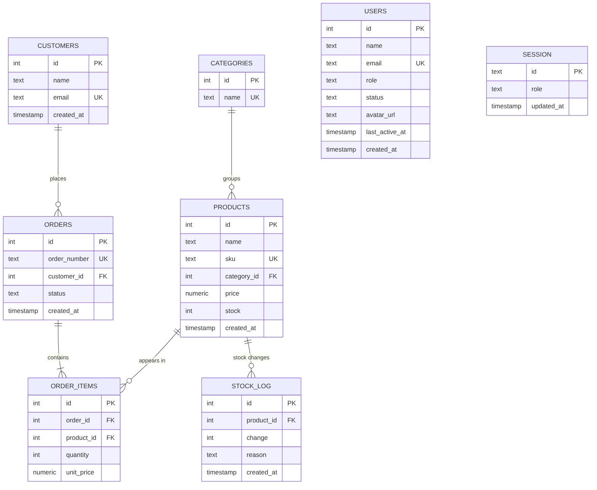

# NexusOps Admin Dashboard: DBMS Capstone Report

**Project:** Admin Dashboard System (React + Express + PostgreSQL)
**Database:** PostgreSQL 16 (all SQL lives in `artifacts/admin-dashboard/server/schema.sql`)

## 1. What the system does

An e-commerce admin console. Staff log in with one of three roles (admin, manager, user) and manage products, customers' orders, and staff accounts. The dashboard and analytics pages are driven entirely by SQL queries against the database. The **Database** page inside the app shows the live schema and runs the showcase queries below, so the database can be demonstrated without leaving the project.

## 2. ER diagram



The editable source is `er-diagram.mmd` (Mermaid; GitHub renders it directly).

| Relationship | Cardinality | Implemented by |
|---|---|---|
| Customer places Order | 1 : N | `orders.customer_id` -> `customers.id` |
| Order contains Product | M : N | junction table `order_items` |
| Category groups Product | 1 : N | `products.category_id` -> `categories.id` |
| Product has Stock changes | 1 : N | `stock_log.product_id` -> `products.id` |

`users` (dashboard staff) and `session` (demo login role) are standalone: staff are not customers.

## 3. Normalization

The first version of the project stored everything about a sale in one `orders` table:

`orders(id, order_number, customer_name, customer_email, product_name, product_category, amount, status, created_at)`

**Problems (anomalies):**
- *Update anomaly:* a customer's email is repeated on every order, so changing it means editing many rows.
- *Insertion anomaly:* a customer or category cannot exist until an order mentions it.
- *Deletion anomaly:* deleting a customer's only order erases the customer.
- *Redundancy:* `amount` could disagree with the product's price.
- An order could hold only one product.

**1NF:** every column holds a single atomic value. The "many products per order" case is a set of rows in `order_items`, not a list inside one cell.

**2NF:** no partial dependencies. In `order_items`, `quantity` and `unit_price` depend on the whole key (which order *and* which product). Product name, SKU and category live in `products`, which depend only on the product.

**3NF:** no transitive dependencies. Before: `order -> product_name -> product_category`. Now the order only references a product, and the product references a category. Customer name and email depend on the customer, not on the order, so they sit in `customers`. The order total is **not stored**. It is derived by the view `v_order_totals` (`SUM(quantity * unit_price)`).

`unit_price` in `order_items` is not redundant with `products.price`: it records the price **at the time of sale**, which must not change when the catalogue price changes later.

## 4. Tables

| Table | Primary key | Foreign keys | Other constraints |
|---|---|---|---|
| `customers` | id | none | `email` UNIQUE |
| `categories` | id | none | `name` UNIQUE |
| `products` | id | `category_id` -> categories (RESTRICT) | `sku` UNIQUE, `price >= 0`, `stock >= 0` |
| `orders` | id | `customer_id` -> customers (RESTRICT) | `order_number` UNIQUE, `status` CHECK in (pending, paid, shipped, refunded, cancelled) |
| `order_items` | id | `order_id` -> orders (CASCADE), `product_id` -> products (RESTRICT) | `quantity > 0`, UNIQUE (order_id, product_id) |
| `stock_log` | id | `product_id` -> products (CASCADE) | audit trail written by triggers |
| `users` | id | none | `email` UNIQUE, `role` and `status` CHECK |
| `session` | id | none | `role` CHECK |

**Referential actions explained:** `RESTRICT` stops you deleting a product that has been sold (history stays intact); `CASCADE` on `order_items.order_id` removes an order's lines when the order is deleted.

**Indexes:** on every foreign key plus `orders.created_at` and `orders.status` (the columns the dashboard filters and sorts by).

## 5. Views

| View | Purpose |
|---|---|
| `v_order_totals` | units and total per order (derived, never stored) |
| `v_orders_detail` | order + customer + product names, used by the Sales page |
| `v_sales_by_category` | revenue per category (excludes cancelled/refunded) |
| `v_top_products` | revenue per product |
| `v_customer_ranking` | lifetime value with `RANK() OVER (...)` |
| `v_low_stock` | products with stock below 5 |

## 6. Function and triggers

**Function:** `fn_customer_lifetime_value(customer_id)` returns a customer's total spend.

**Triggers** keep `products.stock` correct automatically, whatever the application does:

| Trigger | Fires | Effect |
|---|---|---|
| `order_items_stock` | BEFORE INSERT on `order_items` | reduces stock; raises an error if there is not enough stock; writes `stock_log` |
| `orders_status_stock` | BEFORE UPDATE of `orders.status` | cancelling/refunding returns stock; re-opening takes it again |
| `orders_delete_stock` | BEFORE DELETE on `orders` | returns stock of a live order |

## 7. Transaction

Placing an order (`POST /api/orders`, `server/routes/orders.js`) runs as one transaction:

1. find or create the customer by email
2. insert the order
3. insert each order line at the product's current price (the trigger lowers stock)

If any step fails, for example not enough stock, `ROLLBACK` undoes everything, so no half-created order and no stray customer remain. This demonstrates **Atomicity**; the CHECK/FK/UNIQUE constraints demonstrate **Consistency**.

## 8. Showcase SQL (also runnable on the Database page)

| Query | Concept |
|---|---|
| Latest order lines | 4-table INNER JOIN |
| Revenue per category | GROUP BY, HAVING, SUM, COUNT |
| Top customers | VIEW + `RANK() OVER` window function |
| Monthly revenue and change | CTE (`WITH`) + `LAG()` |
| Orders above the average order | subquery |
| Low stock | VIEW with WHERE |
| Latest automatic stock changes | trigger output (`stock_log`) |

## 9. Demo script (viva)

1. Open **Database** -> *Schema*: show tables, keys and constraints.
2. Open **Sales** -> *New order*: pick products, place the order.
3. Open **Products**: that product's stock has dropped (trigger).
4. Back on **Sales**, set that order to *cancelled*: stock returns.
5. Try to order more than the stock: the error appears and nothing is saved (transaction rollback).
6. Open **Database** -> *SQL queries* -> *Latest automatic stock changes*: the audit rows from steps 2-4 are there.
7. Show *Revenue per category* and compare with the Analytics chart (same SQL view).

## 10. How to run

```
pnpm install
# set DATABASE_URL to a PostgreSQL database (Replit provides this)
pnpm --filter @workspace/admin-dashboard run seed   # drop, recreate, load demo data
pnpm --filter @workspace/admin-dashboard run dev
```

The server also creates the schema and seeds demo data automatically on first start. If it finds a database from the old, un-normalized version it rebuilds it.
